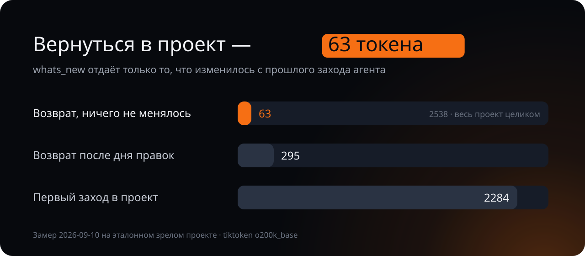
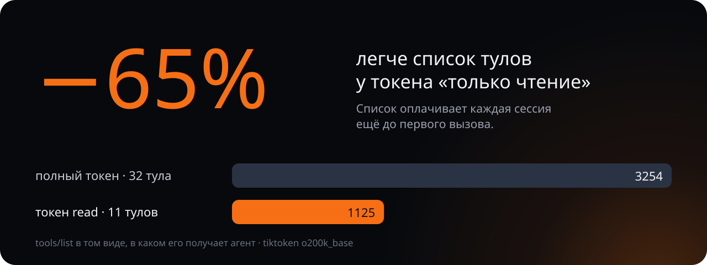

<p align="center">
  
</p>

<h3 align="center">Память проектов, задачи и уведомления в Telegram — для агента в твоей IDE</h3>

<p align="center">
  <a href="README.en.md">English</a> ·
  <a href="https://chip-ai.digital/mcp">chip-ai.digital/mcp</a> ·
  <a href="https://t.me/ChipAI_robot">Бот в Telegram</a> ·
  <a href="https://chip-ai.digital/mcp/spec.json">Живая спека</a>
</p>

Каждая новая сессия агента начинается с пустого контекста. Чип — та часть, которая
не обнуляется: MCP-сервер подключает Claude Code, Cursor или любой другой MCP-клиент
к твоему аккаунту Чипа, где между сессиями живут решения проекта, грабли, задачи
и история.

## Что получает агент

**Память, которая переживает контекст.** Решения вместе с причиной, грабли в виде
*симптом → причина → лечение*, журнал сессий и карта проекта. Новая сессия зовёт
`whats_new` и получает только то, что изменилось с её прошлого захода.

**Задачи с телефона.** Кинул задачу в Telegram — агент найдёт её в `list_tasks`,
а сделав, закроет через `complete_task` с одной строкой о результате. Агент и сам
может оставить задачу своей следующей сессии через `add_task`.

**Способ до тебя достучаться.** `notify_me` шлёт сообщение в Telegram, когда
досчиталась долгая сборка. `ask_user` задаёт вопрос с кнопками, а `check_confirmation`
подбирает ответ позже — агент, работающий в одиночку, дожидается твоего решения,
а не гадает. `set_reminder` ставит напоминание на потом.

**Дела в фоне.** `errand_plan` превращает цель в многошаговое дело (поиск, таблица,
отчёт, презентация) и показывает план и цену до того, как что-то запустится.
Одобряешь — и `errand_result` возвращает отчёт и файлы.

<p align="center">
  
</p>

## В цифрах

<p align="center">
  
</p>

Возврат в проект стоит 63 токена вместо 2538: агент читает разницу, а не весь проект
заново. Замер на эталонном зрелом проекте, честный счётчик `tiktoken o200k_base`,
а не оценка.

<details>
<summary>Те же цифры таблицей</summary>

| сценарий | весь проект | с `whats_new` |
|---|---:|---:|
| первый заход в проект | 2538 токенов | 2284 токена |
| возврат, ничего не менялось | 2538 токенов | **63 токена** |
| возврат, за день накопились правки | 2538 токенов | 295 токенов |

</details>

<p align="center">
  
</p>

Список инструментов оплачивается каждой сессией до первого вызова: 32 тула = 3254
токена, 11 читающих = 1125. Если агент проект только читает — выпусти `read`-токен
и сэкономь 2129 токенов на сессию.

## Подключение

**1. Возьми токен.** Открой [@ChipAI_robot](https://t.me/ChipAI_robot) в Telegram →
мини-приложение → **Chip MCP** → выпусти токен (`chip_mcp_…`). Аккаунт и токен
бесплатные, а память проектов и сообщения в Telegram открываются с тарифа **«Базовый»**
(см. [Деньги](#деньги)). Режим **«Чтение»** — если хочешь, чтобы агент смотрел, но ничего
не трогал.

**2. Подключи клиент.**

Claude Code:

```bash
claude mcp add --transport http chip https://chip-ai.digital/mcp --header "Authorization: Bearer chip_mcp_ТВОЙ_ТОКЕН"
```

Cursor — `~/.cursor/mcp.json` (или `.cursor/mcp.json` в проекте):

```json
{
  "mcpServers": {
    "chip": {
      "url": "https://chip-ai.digital/mcp",
      "headers": { "Authorization": "Bearer chip_mcp_ТВОЙ_ТОКЕН" }
    }
  }
}
```

Любой другой клиент, принимающий запись `mcpServers` с `url` и `headers`, работает
так же. Другие клиенты — в [docs/clients.md](docs/clients.md).

**3. Начни с `whats_new`.** Сервер и сам просит об этом в своей инструкции, так что
большинство агентов делают это без напоминания.

## Плагин для Claude Code

Одна установка вместо ручного конфига: сервер, ритуал сессии и две команды.

```bash
export CHIP_MCP_TOKEN=chip_mcp_ТВОЙ_ТОКЕН
claude plugin marketplace add zapret-digital/chip-mcp
claude plugin install chip@chip-ai
```

Токен живёт **только** в переменной `CHIP_MCP_TOKEN`. В файлы плагина он не попадает
никогда, в `.chip.json` — тоже.

Что приносит плагин:

- сервер `chip`, нацеленный на `https://chip-ai.digital/mcp/` — адрес зашит в плагин
  литералом, переменной окружения его не увести;
- `/chip:start` и `/chip:finish` — тот же ритуал сессии, что у промптов сервера
  `start` и `finish`, для клиентов, которые промпты не рисуют;
- три хука: в начале сессии дельта проекта уезжает в контекст, перед сжатием контекста
  и на выходе агенту напоминают сохранить сводку.

Хукам нужен `.chip.json` в корне репозитория — по нему они понимают, о каком проекте
речь:

```json
{ "project_id": 12 }
```

Файл присылает мини-апп: настройки проекта, кнопка **«Правила для IDE-агента»**, рядом
с `AGENTS.md`. Telegram срезает точку в начале имени вложения, так что после
сохранения переименуй файл обратно в `.chip.json`. Файла нет — хуки молчат, кроме
одной строки на старте сессии: «в этом репозитории нет .chip.json». Плагин при этом
работает, просто сессия начинается без дельты.

Хук никогда не роняет сессию: нет токена, нет сети, нет `python3` или `curl` —
получишь одну строку с объяснением, а не несостоявшийся старт.

<details>
<summary>Для разработчика</summary>

`CHIP_MCP_URL` перенацеливает **только хуки** и только на прод-адрес или локальный
стенд (`http://127.0.0.1:PORT/mcp/`), остальное отвергается. Сам MCP-канал переменную
не читает, поэтому чужой репозиторий не уведёт твой токен на свой хост через
`.claude/settings.json`.

</details>

## Инструменты

32 штуки. Токен `read` получает 11 помеченных *чтение*, токен `full` — все.

<!-- tools:start -->
| Инструмент | Доступ | Аргументы |
|---|---|---|
| `add_note` | запись | `project_id`, `text`, `kind` |
| `add_task` | запись | `project_id`, `text` |
| `archive_project` | запись | `project_id` |
| `ask_user` | запись | `question`, `options` |
| `attach_file` | запись | `filename`, `size_bytes` |
| `check_confirmation` | запись | `ask_id` |
| `complete_task` | запись | `task_id`, `result` |
| `create_project` | запись | `name` |
| `errand_cancel` | запись | `errand_id` |
| `errand_plan` | запись | `goal`, `project_id`, `files`, `run_at`, `ready_by` |
| `errand_result` | запись | `errand_id` |
| `errand_start` | запись | `errand_id`, `mode`, `max_credits` |
| `errand_status` | запись | `errand_id` |
| `finalize_upload` | запись | `upload_id` |
| `generate_image` | запись | `prompt`, `project_id` |
| `get_project_context` | чтение | `project_id`, `depth` |
| `get_project_map` | запись | `project_id` |
| `list_files` | чтение | `project_id` |
| `list_projects` | чтение | — |
| `list_tasks` | чтение | `project_id`, `offset`, `task_id` |
| `notify_me` | запись | `text`, `upload_id` |
| `read_journal` | чтение | `project_id`, `offset` |
| `read_map_section` | чтение | `project_id`, `section` |
| `read_project_dialog` | чтение | `project_id`, `session_id` |
| `read_project_file` | чтение | `project_id`, `filename`, `page` |
| `rename_project` | запись | `project_id`, `name` |
| `save_session_summary` | запись | `project_id`, `text` |
| `search_project` | чтение | `query`, `project_id`, `kind`, `since` |
| `set_reminder` | запись | `text`, `when` |
| `upload_project_file` | запись | `project_id`, `filename`, `size_bytes`, `content` |
| `whats_new` | чтение | `project_id`, `since`, `session` |
| `whoami` | чтение | — |
<!-- tools:end -->

`get_project_map` читает оглавление, но помечен как *запись*, и это осознанно:
получение оглавления попутно пересобирает карту проекта, поэтому токену «только
чтение» он недоступен. Отдельная статья читается через `read_map_section` без
побочных эффектов.

Машиночитаемо — [spec.json](spec.json), собран из реестра инструментов самого
сервера.

## Что сервер видит, а чего не может

- **Доступа к твоей файловой системе нет.** Он получает ровно то, что агент сам
  передал в аргументах. Репозиторий никто не сканирует.
- **Аргументы и результаты вызовов не логируются.** В журнале — имя инструмента,
  длительность и признак успеха, больше ничего.
- **Токен `read` не может писать.** Запрет на самом вызове, а не только скрытием
  инструментов из списка.
- **Токены хранятся как SHA-256.** Сырое значение показывается один раз, при выпуске.
- Список инструментов отдаётся без токена — чтобы каталоги MCP могли
  проиндексировать сервер. Любой реальный вызов требует токен.

## Как проверить спеку самому

`spec.json` в этом репозитории собран из реестра инструментов живого сервера, поэтому
разъехаться с реальностью он не может. Сверь с продом:

```bash
./scripts/verify.sh
```

Скрипт сравнивает закоммиченную спеку с `https://chip-ai.digital/mcp/spec.json`.

## Деньги

Аккаунт и подключение бесплатны. Проекты (память, поручения, журнал) и сообщения
в Telegram открываются с тарифа **«Базовый»**. Чтение своих проектов не тарифицируется;
записи, сообщения в Telegram и генерация картинок считаются по лимитам тарифа — тулы
сами скажут агенту, когда лимит исчерпан и что с этим делать. Дела оплачиваются
кредитами Чипа, цена видна до запуска. Тарифы живут в боте.

## Лицензия

[MIT](LICENSE) на содержимое этого репозитория (спека, документация, скрипты). Сам
сервис Чип — проприетарный.
