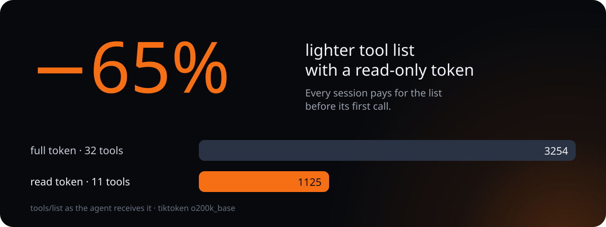

<p align="center">
  
</p>

<h3 align="center">Project memory, tasks and Telegram notifications for your coding agent</h3>

<p align="center">
  <a href="README.ru.md">Русская версия</a> ·
  <a href="https://chip-ai.digital/mcp">chip-ai.digital/mcp</a> ·
  <a href="https://t.me/ChipAI_robot">Telegram bot</a> ·
  <a href="https://chip-ai.digital/mcp/spec.json">Live spec</a>
</p>

Every new agent session starts with an empty context. Chip is the part that doesn't:
an MCP server that connects Claude Code, Cursor or any other MCP client to your Chip
account, where the project's decisions, pitfalls, tasks and history live between
sessions.

> **Language note.** Chip is a Russian-language product: the tools answer in Russian
> and billing is in rubles. Everything works from any country, but if you don't read
> Russian, the responses will not be useful to you.

## What your agent gets

**Memory that outlives the context window.** Decisions with the reason behind them,
pitfalls written as *symptom → cause → fix*, a journal of sessions and a map of the
project. A new session calls `whats_new` and gets only what changed since its last
visit.

**Tasks from your phone.** Drop a task in Telegram and the agent finds it in
`list_tasks`, then closes it with `complete_task` and a line about what was done. The
agent can leave tasks for its own next session with `add_task`.

**A way to reach you.** `notify_me` sends a message to your Telegram when a long build
finishes. `ask_user` asks a question with buttons, and `check_confirmation` picks up
the answer later, so an agent working alone waits for your decision instead of
guessing. `set_reminder` schedules a nudge for later.

**Errands in the background.** `errand_plan` turns a goal into a multi-step job
(search, a table, a report, a deck) and shows the plan and the price before anything
runs. You approve it, and `errand_result` brings back the report and the files.

<p align="center">
  
</p>

## In numbers

<p align="center">
  
</p>

Coming back to a project costs 63 tokens instead of 2538: the agent reads the delta,
not the whole project again. Measured on a reference mature project with real
`tiktoken o200k_base` counting, not estimated.

<details>
<summary>The same numbers as a table</summary>

| scenario | whole project | with `whats_new` |
|---|---:|---:|
| first visit to a project | 2538 tokens | 2284 tokens |
| returning, nothing changed | 2538 tokens | **63 tokens** |
| returning after a day of edits | 2538 tokens | 295 tokens |

</details>

<p align="center">
  
</p>

The tool list is paid for by every session before the first call: 32 tools = 3254
tokens, the 11 read-only ones = 1125. If your agent only reads the project, issue a
`read` token and save 2129 tokens per session.

## Install

**1. Get a token.** Open [@ChipAI_robot](https://t.me/ChipAI_robot) in Telegram →
mini app → **Chip MCP** → issue a token (`chip_mcp_…`). The account and the token are
free; project memory and Telegram messages need the **Basic** plan (see
[Pricing](#pricing)). Choose **read** if you want the agent to look but never touch.

**2. Connect your client.**

Claude Code:

```bash
claude mcp add --transport http chip https://chip-ai.digital/mcp --header "Authorization: Bearer chip_mcp_YOUR_TOKEN"
```

Cursor — `~/.cursor/mcp.json` (or `.cursor/mcp.json` in the project):

```json
{
  "mcpServers": {
    "chip": {
      "url": "https://chip-ai.digital/mcp",
      "headers": { "Authorization": "Bearer chip_mcp_YOUR_TOKEN" }
    }
  }
}
```

Any other client that takes an `mcpServers` entry with `url` + `headers` works the
same way. More clients in [docs/clients.md](docs/clients.md).

**3. Start with `whats_new`.** The server's own instructions say so too, so most
agents do it unprompted.

## Claude Code plugin

One install instead of wiring the config by hand: the server, the session ritual and
two commands.

```bash
export CHIP_MCP_TOKEN=chip_mcp_YOUR_TOKEN
claude plugin marketplace add zapret-digital/chip-mcp
claude plugin install chip@chip-ai
```

The token lives **only** in `CHIP_MCP_TOKEN`. It is never written into the plugin
files, and never into `.chip.json`.

What the plugin adds:

- the `chip` MCP server, pointed at `https://chip-ai.digital/mcp/` — the address is
  a literal in the plugin, not something the environment can re-point;
- `/chip:start` and `/chip:finish` — the same session ritual as the server's `start`
  and `finish` prompts, for clients that don't render prompts;
- three hooks: on session start the project delta goes into the context; before
  context compaction and on stop the agent is reminded to save the summary.

The hooks need a `.chip.json` in the repository root to know which project this is:

```json
{ "project_id": 12 }
```

The mini app sends it to you — project settings, **«Правила для IDE-агента»**, next to
`AGENTS.md`. Telegram strips the leading dot from attachment names, so rename the file
back to `.chip.json` after saving. Without the file the hooks stay quiet, except for
one line at session start saying this repository has no `.chip.json`. The plugin still
works, the session just starts without the delta.

The hooks never block a session. No token, no network, no `python3` or `curl` — you
get one line of explanation instead of a failed start.

<details>
<summary>For local development</summary>

`CHIP_MCP_URL` re-points **the hooks only**, and only at the production address or a
loopback stand (`http://127.0.0.1:PORT/mcp/`); anything else is refused. The MCP
channel itself ignores the variable, so no repository can send your token to its own
host through `.claude/settings.json`.

</details>

## Tools

32 tools. `read` tokens get the 11 marked *read*; `full` tokens get everything.

<!-- tools:start -->
| Tool | Access | Arguments |
|---|---|---|
| `add_note` | write | `project_id`, `text`, `kind` |
| `add_task` | write | `project_id`, `text` |
| `archive_project` | write | `project_id` |
| `ask_user` | write | `question`, `options` |
| `attach_file` | write | `filename`, `size_bytes` |
| `check_confirmation` | write | `ask_id` |
| `complete_task` | write | `task_id`, `result` |
| `create_project` | write | `name` |
| `errand_cancel` | write | `errand_id` |
| `errand_plan` | write | `goal`, `project_id`, `files`, `run_at`, `ready_by` |
| `errand_result` | write | `errand_id` |
| `errand_start` | write | `errand_id`, `mode`, `max_credits` |
| `errand_status` | write | `errand_id` |
| `finalize_upload` | write | `upload_id` |
| `generate_image` | write | `prompt`, `project_id` |
| `get_project_context` | read | `project_id`, `depth` |
| `get_project_map` | write | `project_id` |
| `list_files` | read | `project_id` |
| `list_projects` | read | — |
| `list_tasks` | read | `project_id`, `offset`, `task_id` |
| `notify_me` | write | `text`, `upload_id` |
| `read_journal` | read | `project_id`, `offset` |
| `read_map_section` | read | `project_id`, `section` |
| `read_project_dialog` | read | `project_id`, `session_id` |
| `read_project_file` | read | `project_id`, `filename`, `page` |
| `rename_project` | write | `project_id`, `name` |
| `save_session_summary` | write | `project_id`, `text` |
| `search_project` | read | `query`, `project_id`, `kind`, `since` |
| `set_reminder` | write | `text`, `when` |
| `upload_project_file` | write | `project_id`, `filename`, `size_bytes`, `content` |
| `whats_new` | read | `project_id`, `since`, `session` |
| `whoami` | read | — |
<!-- tools:end -->

`get_project_map` reads a table of contents but is listed as *write*, and that is
deliberate: fetching it also refreshes the project map, so a read-only token does not
get it. `read_map_section` reads a single entry without side effects.

Machine-readable: [spec.json](spec.json), generated from the server's own tool
registry.

## What the server can and cannot see

- **It has no access to your filesystem.** It only ever receives what your agent
  explicitly passes as arguments. Nothing scans your repository.
- **Call arguments and results are not logged.** The usage log stores the tool name,
  duration and success flag — nothing else.
- **A `read` token cannot write.** Enforced on the call itself, not just by hiding
  tools from the list.
- **Tokens are stored as SHA-256.** The raw value is shown once, at issue time.
- Listing tools needs no token, so directories can index this server. Every actual
  call does.

## Verify the spec yourself

`spec.json` in this repo is generated from the live server's tool registry, so it
cannot quietly drift from reality. Check it against production:

```bash
./scripts/verify.sh
```

It diffs the committed spec against `https://chip-ai.digital/mcp/spec.json`.

## Pricing

The account and connecting are free. Projects (memory, tasks, journal) and Telegram
messages open with the **Basic** plan. Reading your projects is not metered; writes,
Telegram messages and image generation count against your plan's limits — the tools
tell your agent when a limit is reached and what to do about it. Errands are paid
with Chip credits, and the price is shown before the start. Plans live in the
Telegram bot.

## License

[MIT](LICENSE) for the contents of this repository (spec, docs, scripts). The Chip
service itself is proprietary.
